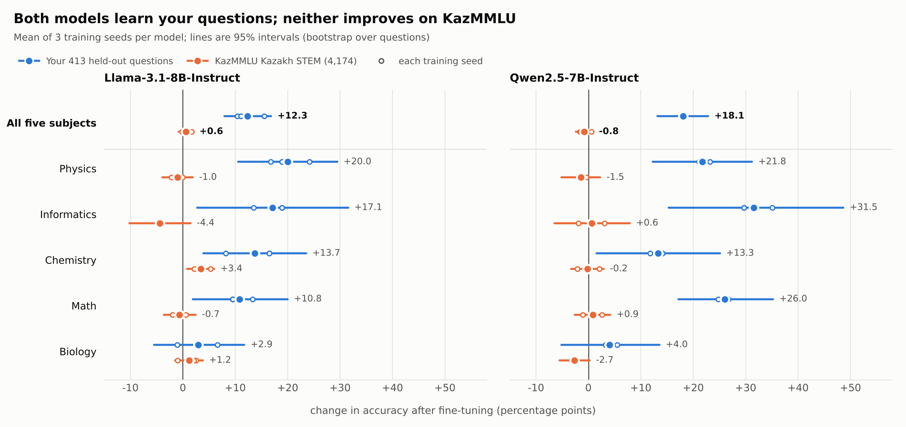

# Does fine-tuning on new Kazakh STEM questions improve KazMMLU?

I made 2,000 multiple-choice questions in Kazakh (school math, physics, chemistry, biology and informatics, grades 7–11), fine-tuned two open models on them with LoRA, and tested whether they improve on [KazMMLU](https://huggingface.co/datasets/MBZUAI/KazMMLU).

They did not. Both models got much better on my held-out questions, but their KazMMLU scores stayed the same.



| Accuracy, % | Llama-3.1-8B-Instruct | Qwen2.5-7B-Instruct |
|---|---|---|
| My held-out questions (413) | 43.3 → 55.7 (+12.3) | 43.3 → 61.4 (+18.1) |
| KazMMLU Kazakh STEM (4,174) | 40.8 → 41.3 (+0.6) | 47.0 → 46.2 (−0.8) |
| KazMMLU Kazakh non-STEM (2,045) | 42.1 → 42.0 (−0.1) | 36.9 → 37.5 (+0.6) |

After-training values are the mean of three training seeds. 95% bootstrap intervals for the change: held-out +7.9 to +16.9 (Llama) and +13.2 to +22.8 (Qwen); KazMMLU STEM −0.8 to +2.0 and −2.4 to +0.8.

Data: [Sanim09/kazakh-stem-mcq-2000](https://huggingface.co/datasets/Sanim09/kazakh-stem-mcq-2000). Adapters: [Llama](https://huggingface.co/Sanim09/Llama-3.1-8B-Instruct-KazSTEM-LoRA), [Qwen](https://huggingface.co/Sanim09/Qwen2.5-7B-Instruct-KazSTEM-LoRA).

## Setup

- **Data.** 2,000 five-option questions. 413 are held out for testing, 1,408 are used for training and 169 for choosing the epoch. Before training I compared every question with all KazMMLU Kazakh STEM questions (TF-IDF and LaBSE) and left the 10 closest ones out of training. Some questions I wrote myself and some were drafted with an AI assistant; I checked all of them.
- **Training.** LoRA, r = 16, alpha = 16, on all attention and MLP projections. Learning rate 2e-4, batch 8, 2 epochs, keeping the epoch with the best validation accuracy. The loss is on the answer letter only. Settings were fixed before training and are the same for every run. Kaggle, 2 × T4.
- **Evaluation.** Zero-shot: an English instruction, the question and options in Kazakh, the model's chat template. The prediction is the answer letter with the highest probability. KazMMLU test split, Kazakh-language subjects only.
- **Statistics.** Exact McNemar test for each run; bootstrap over questions for the three-seed mean; Holm correction across subjects.

## Checks

- **Near-copies.** The 338 held-out questions that are not similar to any training question (similarity below 0.6) still improve by +10.8 (Llama) and +16.2 (Qwen).
- **Look-alikes.** KazMMLU questions that resemble my training questions do not improve more than the rest.
- **Letter bias.** After training, both models answer "D" too often on KazMMLU's 4-option questions. Correcting for this without using the answer key still gives no gain: Llama 41.7 → 41.4, Qwen 47.2 → 46.8.
- **Seeds.** One of the six runs reached p < 0.05 on KazMMLU (Llama seed 2, +1.7, uncorrected). The other two Llama seeds gave −0.2 and +0.2.
- **Answer keys.** A re-check of 36 keys, including the 16 held-out questions that every run got wrong in the same way, found no errors.
- **Reproducibility.** Re-running the Qwen baseline gave identical numbers.

By subject, biology gained least on my questions in both models (+2.9 and +4.0); math, physics and informatics gained 11 to 32 points.

## Limitations

- My questions have five options and KazMMLU mostly has four, so part of the gap may be format.
- The held-out questions come from the same source as the training questions. The +12 and +18 show the models learned this set, not general knowledge.
- Training targets only the letter, with no solutions.
- Two models, one training recipe, one prompt.

## Files

| Files | Contents |
|---|---|
| `overlap_check.ipynb`, `train_lora.ipynb`, `eval_kazmmlu.ipynb` | Kaggle notebooks: KazMMLU similarity check, training (one seed per run), scoring |
| `make_*_nb.py`, `kazstem_common.py` | Scripts that build the notebooks; shared prompt code |
| `validate_questions.py`, `hf_to_notebook_inputs.py` | Data checks before release; converts the Hugging Face data into the notebook inputs |
| `results_<run>.csv` | One row per question per run: answer key, prediction, letter probabilities |
| `compare_*.txt`, `three_seed_summary_*`, `robustness_checks.*`, `near_train_check_*` | Results of the analysis scripts |
| `compare.py`, `aggregate.py`, `robustness_checks.py`, `near_train_check.py`, `plot_two_models.py` | Analysis scripts |
| `overlap_*.csv`, `heldout_similarity.csv`, `training_runs.csv` | Similarity results; epoch kept for each seed |

KazMMLU questions appear only as their KazMMLU `ID`.

## Reproduce

1. `python hf_to_notebook_inputs.py` and upload the two output files to Kaggle as a dataset.
2. In each notebook set GPU T4 x2, Internet on, and an `HF_TOKEN` secret (needed for Llama).
3. `eval_kazmmlu.ipynb` with `USE_ADAPTER = False` gives the baseline.
4. `train_lora.ipynb` with `MODEL` and `SEED` (1, 2, 3) trains an adapter.
5. `eval_kazmmlu.ipynb` with `USE_ADAPTER = True` and that training run as input scores it.
6. `python aggregate.py --out=three_seed_summary_qwen.csv results_base_qwen.csv results_tuned_qwen_seed{1,2,3}.csv`, and similarly for the other scripts.

Versions: torch 2.11.0, transformers 5.20.2, peft 0.21.2. Kaggle's torchao 0.10 blocks peft, so the notebooks uninstall it first.

## License and citation

Code: MIT. Questions: CC BY 4.0. Llama adapter: Llama 3.1 Community License (Built with Llama). Qwen adapter: Apache 2.0. KazMMLU (CC BY-NC 4.0) is not included.

```bibtex
@misc{sanim09_kazstem_2026,
  author       = {Sanim09},
  title        = {Kazakh STEM fine-tuning and KazMMLU},
  year         = {2026},
  howpublished = {\url{https://github.com/sanim-science/kazakh-stem-llm}}
}
```

KazMMLU: Togmanov et al., 2025, [arXiv:2502.12829](https://arxiv.org/abs/2502.12829). The code and analysis were written with help from Claude (Anthropic).
